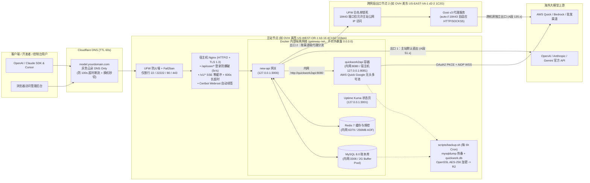

# AI API 中转站全栈实施步骤与实战踩坑复刻指南

> **文档定位**：基于 2026-11-22 ~ 11-23 晚间在 `建站` 目录下的 **4 场完整实战会话记录**（架构选型与主站上线、OVH 美区赠金盘点与多云纳管、AWS Quick 无头多号池 `quickwork2api` 容器化集成、跨机房跨 A/B/C 网段多 IP 出口代理防风控）提炼而成。  
> **核心目标**：下一次拿到新的云厂商赠金号（OVH / AWS / GCP / Azure / DigitalOcean）或迁移新服务器时，**照单复制粘贴即可在 15~20 分钟内 1:1 复刻整套生产级 AI 中转站，并避开所有已知暗坑**。

---

## 一、 生产环境最终落地的全栈架构全景



---

## 二、 从 0 到 1 标准实施步骤（7 阶段完整复刻 SOP）

### 阶段一：OVH 赠金号盘点、选区与开鸡（含 `cloud-init` 破除 22 端口封锁）

#### 1. 赠金与选区核查要点
1. 登录 OVHcloud 控制台（美区 `https://manager.us.ovhcloud.com`），进入 `Public Cloud -> Credits & Vouchers` 核查 `VOUCHER-PUBLIC_CLOUD` 余额与**到期日**。
2. 进入 `Quota and Regions` 检查各机房配额：
   - **美西 `US-WEST-OR-1`（俄勒冈）**：离国内及 OpenAI/Anthropic 物理距离近（实测到 OpenAI/Claude/Gemini TLS 握手仅 `38ms ~ 120ms`），但默认配额较紧（`3 台 / 6 vCPU / 21 GB RAM`），单机最高可开 **`b3-16`（4C16G / 1Gbps 公网，`$0.1412/hr`）** 或性价比 **`d2-8`（4C8G / 500Mbps，`$0.0493/hr`）**。
   - **美东 `US-EAST-VA-1`（弗吉尼亚）**：配额极其宽裕（`10 台 / 34 vCPU / 430 GB RAM / 15 Floating IP`），适合开高配机器或作为**跨网段第二出口节点（`d2-2` 1C2G 仅 `$0.0161/hr` ≈ `$0.38/天`）**。
3. **计费避坑**：短期测试或赠金充裕追求顶配带宽时选 **按小时计费（Hourly）**；长期跑 `d2`/`b2` 机型且确定跑满 1 个月以上可选 **包月（Monthly）**。**开机时务必取消勾选 Auto-backup（自动备份）**。

#### 2. 本地生成 SSH 密钥对并收紧 Windows 权限
在本地 Windows PowerShell 执行（**注意：私钥必须同时复制到纯英文路径 `~/.ssh/` 下，避免中文路径或继承权限导致 OpenSSH 报错**）：

```powershell
# 1. 生成专用 Ed25519 密钥对
mkdir -Force "$env:USERPROFILE\.ssh"
ssh-keygen -t ed25519 -C "ovh-us-llm-gateway" -f "$env:USERPROFILE\.ssh\ovh_us_gateway" -N '""'

# 2. 收紧 Windows 私钥 ACL 权限（移除继承，仅当前用户只读，否则 ssh 会报 UNPROTECTED PRIVATE KEY FILE）
icacls "$env:USERPROFILE\.ssh\ovh_us_gateway" /inheritance:r /grant:r "$($env:USERNAME):(R)"

# 3. 查看公钥内容，准备粘贴到 OVH 控制台
Get-Content "$env:USERPROFILE\.ssh\ovh_us_gateway.pub"
```

#### 3. 創建实例必填 `cloud-init` 启动脚本（核心避坑！）
由于国内运营商及绝大多数 Clash 代理节点默认封禁出站 `22` 端口，且 **Ubuntu 24.04 默认使用 `ssh.socket` 动态接管端口**（仅改 `sshd_config` 不会监听新端口），在 OVH 创建 Ubuntu 24.04 实例时，展开 ** Startup script (`cloud-init` / User Data)** 填入以下脚本，开机即原生同时监听 `22` 和 `22222`：

```yaml
#cloud-config
runcmd:
  - |
    cat > /etc/ssh/sshd_config.d/99-custom-ports.conf <<'EOF'
    Port 22
    Port 22222
    PasswordAuthentication no
    EOF
    systemctl disable --now ssh.socket || true
    systemctl enable --now ssh.service
    systemctl restart ssh.service
```

#### 4. 配置本机 `~/.ssh/config` 并验收上游连通性
拿到实例公网 IP（假设为 `<MAIN_IP>`）后，写入本机 `C:\Users\<用户名>\.ssh\config`：

```ssh-config
Host ovh-gateway
    HostName <MAIN_IP>
    Port 22222
    User ubuntu
    IdentityFile ~/.ssh/ovh_us_gateway
    ServerAliveInterval 30
    ServerAliveCountMax 3
```

一键测试免代理直连与三大 AI 上游建连速度：

```powershell
ssh ovh-gateway 'for u in https://api.openai.com https://api.anthropic.com https://generativelanguage.googleapis.com; do printf "%-44s " "$u"; curl -o /dev/null -s -m 10 -w "DNS:%{time_namelookup}s TCP:%{time_connect}s TLS:%{time_appconnect}s HTTP:%{http_code}\n" "$u"; done'
```
> **验收标准**：本机无需开代理即可通过 `22222` 端口秒连服务器；服务器到三大上游 `TLS` 耗时 `< 0.30s`，且不返回 `403`。

---

### 阶段二：服务器基线初始化与核心容器栈部署

#### 1. 在本地生成高强度生产 `.env`（严禁含特殊 URL 字符）
在本地项目根目录用 Python 一键生成随机密钥（MySQL/Redis 密码使用纯字母数字，防止 `@ / : ?` 破坏 `SQL_DSN` 解析）：

```powershell
@'
import secrets, string

def rand_alnum(n=28):
    alphabet = string.ascii_letters + string.digits
    return ''.join(secrets.choice(alphabet) for _ in range(n))

env_text = f"""# AI API 中转站生产环境变量（请离线妥善备份，跨云迁机必需！）
TZ=Asia/Shanghai

SESSION_SECRET={secrets.token_hex(32)}
CRYPTO_SECRET={secrets.token_hex(32)}

MYSQL_DATABASE=newapi
MYSQL_USER=newapi
MYSQL_PASSWORD={rand_alnum(28)}
MYSQL_ROOT_PASSWORD={rand_alnum(32)}

REDIS_PASSWORD={rand_alnum(28)}

BATCH_UPDATE_ENABLED=true
BATCH_UPDATE_INTERVAL=5
ERROR_LOG_ENABLED=true
NODE_TYPE=master
MEMORY_CACHE_ENABLED=true

RCLONE_REMOTE=r2:llm-gateway-backups
BACKUP_RETENTION_DAYS=7
BACKUP_ENCRYPT_PASSPHRASE={rand_alnum(32)}
"""
with open(".env.ovh.local", "w", encoding="utf-8", newline="\n") as f:
    f.write(env_text)
print("Generated .env.ovh.local successfully.")
'@ | python -
```
> **红线警告**：`.env.ovh.local` 中的 `CRYPTO_SECRET` 用于加密数据库里的上游渠道 Key，**上线后严禁修改，且必须在本地密码管理器备份一份**！

#### 2. 上传工程文件并清洗 Windows `CRLF` 换行符
```powershell
# 1. 创建远端部署目录
ssh ovh-gateway "sudo mkdir -p /opt/llm-gateway && sudo chown -R ubuntu:ubuntu /opt/llm-gateway"

# 2. 上传配置、脚本与 .env
scp -r docker-compose.yml .env.example mysql nginx scripts ovh-gateway:/opt/llm-gateway/
scp .env.ovh.local ovh-gateway:/opt/llm-gateway/.env

# 3. 清洗 Windows CRLF (\r) 换行符并收紧权限
ssh ovh-gateway "cd /opt/llm-gateway && sed -i 's/\r$//' .env scripts/*.sh mysql/my.cnf docker-compose.yml nginx/conf.d/* && chmod 600 .env && chmod +x scripts/*.sh"
```

#### 3. 执行系统初始化并拉起容器栈
```powershell
ssh ovh-gateway 'set -euo pipefail
cd /opt/llm-gateway
sudo bash scripts/init_server.sh
sudo usermod -aG docker ubuntu || true
sudo cp nginx/conf.d/00-gateway-common.conf /etc/nginx/conf.d/00-gateway-common.conf
sudo nginx -t && sudo systemctl reload nginx
sudo docker compose up -d new-api mysql redis uptime-kuma
sleep 10
sudo docker compose ps
curl -s http://127.0.0.1:3000/api/status
'
```
- `scripts/init_server.sh` 已自动完成：**2GB Swap 挂载**、**TCP BBR 拥塞控制开启**、**`ulimit -n 65535`**、**Docker 安装**、**UFW 防火墙启用（仅放行 `22 / 22222 / 80 / 443`）** 及 **Fail2ban 启动**。

---

### 阶段三：单域名 DNS、Nginx SSE 流式反代与 SSL 自动续签

实战中，采用**单一统一域名**（如 `model.yourdomain.com` 同时提供控制台网页与 `/v1` API 接口）比拆分 3 个子域名更方便分发给朋友和客户。

#### 1. Cloudflare DNS 配置
在 Cloudflare 添加一条 `A` 记录：
- **名称**：`model`（即 `model.yourdomain.com`）
- **IPv4 地址**：`<主站公网IP>`
- **代理状态**：**仅 DNS（灰色云朵，关闭 CF 代理）** —— 避免 Cloudflare 免费版 100 秒超时强行掐断 DeepSeek-R1 / Claude Thinking / o1 等深度思考推理请求，同时省去 CF 边缘绕路延迟。
- **TTL**：**`1 分钟`** —— 以后赠金耗尽换新机时，改 IP 后 60 秒全球无感切换。

#### 2. 签发 Let's Encrypt 证书并无缝切为 Webroot 自动续签
在服务器上执行（将 `model.yourdomain.com` 替换为你的实际域名）：

```bash
export DOMAIN="model.yourdomain.com"
cd /opt/llm-gateway

# 1. 确认 DNS 已生效
getent ahostsv4 "${DOMAIN}"

# 2. 首次使用 standalone 模式签发证书
sudo mkdir -p /var/www/certbot
sudo systemctl stop nginx
sudo certbot certonly --standalone --non-interactive --agree-tos --register-unsafely-without-email -d "${DOMAIN}"

# 3. 【关键避坑】将续签方式从 standalone 改为 webroot，并配置续签后自动 reload nginx（否则 90 天后续签会因 80 端口被 Nginx 占用而失败！）
sudo sed -i 's/authenticator = standalone/authenticator = webroot/' "/etc/letsencrypt/renewal/${DOMAIN}.conf"
if ! grep -q 'webroot_path' "/etc/letsencrypt/renewal/${DOMAIN}.conf"; then
  printf "\nwebroot_path = /var/www/certbot,\n[[webroot_map]]\n%s = /var/www/certbot\n" "${DOMAIN}" | sudo tee -a "/etc/letsencrypt/renewal/${DOMAIN}.conf" >/dev/null
fi
sudo mkdir -p /etc/letsencrypt/renewal-hooks/deploy
printf '#!/bin/sh\nsystemctl reload nginx\n' | sudo tee /etc/letsencrypt/renewal-hooks/deploy/reload-nginx.sh >/dev/null
sudo chmod +x /etc/letsencrypt/renewal-hooks/deploy/reload-nginx.sh

# 4. 生成 Nginx 站点配置并启动 Nginx
sed "s/model.yourdomain.com/${DOMAIN}/g" nginx/conf.d/gateway-unified.conf.template | sudo tee "/etc/nginx/conf.d/${DOMAIN}.conf" >/dev/null
sudo rm -f /etc/nginx/sites-enabled/default
sudo nginx -t && sudo systemctl start nginx

# 5. 验证 HTTPS 接口与免停机自动续签演练
curl -fsS "https://${DOMAIN}/api/status" | jq .
sudo certbot renew --dry-run
```

---

### 阶段四：New API 后台生产初始化与三层分组模型

1. **首次初始化 (`/setup`)**：
   - 浏览器访问 `https://model.yourdomain.com/setup`，设置超级管理员账号与强密码，**务必取消勾选「自用模式」**（启用对外多用户运营模式）。
   - 初始化完成后，管理员与普通用户共用同一登录入口：`https://model.yourdomain.com/sign-in`（管理员登录后左侧自动显示「渠道管理」「用户管理」「系统设置」等全套后台菜单）。
2. **三项必配防刷与运营设置**：
   - **服务器地址**：进入 `系统设置 -> 通用设置`，将服务器地址从默认的 `http://localhost:3000` 改为 `https://model.yourdomain.com`。
   - **新用户初始额度清零（防白嫖必做！）**：在运营设置中将「新用户初始额度」设为 **`$0`**，防止被全网注册机批量注册刷空上游额度；给朋友或客户发额度一律通过「兑换码」或人工充值。
   - **三层用户分组隔离**（`系统设置 -> 计费与倍率 -> 分组倍率`）：
     - `default`（倍率 `1.0x`）：绑定高性价比主力渠道池。
     - `free_fans`（倍率 `1.0x`）：绑定自己的闲置额度/免费号池（如 `AWS-Quick-Pool`），供粉丝和朋友兑换使用。
     - `vip_official`（倍率 `1.5x`）：绑定官方直连高稳渠道，提供高 SLA 服务溢价。

---

### 阶段五：接入 AWS Quick (`aws-quickwork-2api`) 无头 Google 多号池

当你有一批全新未登录过的 Google 账号，想把 AWS Quick 额度接入 New API 且不依赖本地 Windows 桌面客户端时，直接在主站运行封装好的一键部署脚本：

#### 1. 一键编译容器与自动注册渠道
```bash
cd /opt/llm-gateway
bash scripts/deploy_quickwork2api.sh
```
该脚本会自动完成：
1. 拉取 `aws-quickwork-2api` 源码，并用 `golang:1.26-alpine` 容器免环境编译出 `17MB` 静态二进制 `bin/quickproxy`。
2. 生成随机内部鉴权 Key 写入 `aws-quickwork-2api/config.json`，并将监听地址设为 `0.0.0.0:8080`。
3. 启动 `quickwork2api` 容器（宿主机仅绑 `127.0.0.1:8081:8080`，Docker 内网地址 `http://quickwork2api:8080`）。
4. 自动向 New API 的 MySQL `channels` 表注入 `AWS-Quick-Pool` 渠道（绑定 `default,free_fans` 分组，内置 `claude-sonnet-4-5` -> `smart`、`claude-3-5-haiku-20241022` -> `fast` 等模型映射）并重启 `new-api` 刷新缓存。

#### 2. 远程无头添加 Google 账号入池（可重复执行添加多个账号）
```bash
cd /opt/llm-gateway/aws-quickwork-2api
./bin/quickproxy login --provider social -manual
```
1. 终端会打印一条形如 `https://...signin.aws/authorize?...` 的授权 URL，并停在 `Paste redirected URL:` 提示处。
2. 复制该 URL 到你本地电脑的浏览器（建议用无痕窗口）打开，选择 **Continue with Google** 登录你的 Google 账号并完成授权。
3. 授权完成后，浏览器会跳转到一个打不开的 `http://127.0.0.1:18080/oauth/callback?code=...&state=...` 页面（**打不开是正常的！**）。
4. 复制浏览器地址栏里这条完整的 `http://127.0.0.1:18080/oauth/callback?...` 链接，粘贴回 SSH 终端的 `Paste redirected URL:` 并回车，账号即自动入池并由容器后台自动保活刷新 Token！

---

### 阶段六：多 IP 跨 C 段/跨地域防风控出口节点搭建（`gost v3` + UFW 白名单）

当接入多账号或高频请求上游时，单 IP 出口极易触发 Rate Limit 或账号关联封号；且**不能在同一机房直接买附加 IP（会落在同一 `/24` C 段被连坐封禁）**。

#### 1. 跨机房开通超低成本第二出口节点
在 OVH 另一个物理机房（如主站在美西 `US-WEST-OR-1`，则在美东 **`US-EAST-VA-1`**）创建一台最低配的 **`d2-2`**（1C2G，按小时计费仅 **`$0.0161/hr` ≈ `$0.38/天`**，100% 走赠金抵扣，选 Ubuntu 24.04 并勾选同一个 SSH 公钥）。
- 实测分配到的美东 IP（如 `135.148.234.x`）与美西主站 IP（如 `51.81.200.x`）不仅跨 C 段，甚至**跨 A 段、跨物理数据中心**，彻底杜绝网段连坐。

#### 2. 利用主站作 SSH 跳板一键初始化出口节点（免配 cloud-init / 免开 VNC）
哪怕新节点刚开机只监听 `22` 端口（本机直连 `:22` 被封），主站与新节点之间走 OVH 骨干网连 `:22` 是秒通的！直接在本地电脑通过 `-J ovh-gateway` 跳板把 `scripts/init_egress_node.sh` 推过去执行：

```powershell
# 假设新出口节点公网 IP 为 <EGRESS_IP>，主站公网 IP 为 <MAIN_IP>
scp -J ovh-gateway scripts/init_egress_node.sh ubuntu@<EGRESS_IP>:/tmp/init_egress_node.sh
ssh -J ovh-gateway ubuntu@<EGRESS_IP> "sed -i 's/\r$//' /tmp/init_egress_node.sh && sudo bash /tmp/init_egress_node.sh <MAIN_IP> 18443"
```
执行完毕后：
1. 新节点已开启 `22222` 端口（本机可直连）、开启 TCP BBR。
2. `llm-egress-proxy.service`（`gost -L auto://:18443`）已启动并开机自启，同一端口同时支持 HTTP / HTTPS / SOCKS5 代理。
3. **UFW 防火墙已严格锁定 `18443` 端口仅允许 `<MAIN_IP>` 访问**，外网任何其他 IP 扫描均被拦截，彻底杜绝代理被盗刷！

#### 3. 验证双出口并在 New API 按渠道分流
在主站验证双出口 IP：
```bash
# 直出（出口 1）
curl -s https://api.ipify.org
# 走美东 HTTP 代理（出口 2）
curl -s -x http://<EGRESS_IP>:18443 https://api.ipify.org
# 走美东 SOCKS5 代理（出口 2）
curl -s -x socks5h://<EGRESS_IP>:18443 https://api.ipify.org
```
在 New API 后台 **「渠道管理」-> 编辑任意渠道 ->「代理（Proxy）」** 中填入 `http://<EGRESS_IP>:18443` 或 `socks5://<EGRESS_IP>:18443`，该渠道即刻切换至第二出口 IP！

---

### 阶段七：加密热备、R2 异地灾备与 10 分钟跨云迁移 SOP

#### 1. 开启每 6 小时自动加密热备
```bash
# 1. 手动执行一次备份测试（同时备份 MySQL 账本与 quickwork.db 号池，并用 AES-256-CBC 加密）
bash /opt/llm-gateway/scripts/backup.sh
ls -lh /opt/llm-gateway/backups/

# 2. 写入普通用户 crontab（注意日志写到有权限的 backups 目录，且过滤 \r）
echo "0 */6 * * * /opt/llm-gateway/scripts/backup.sh >> /opt/llm-gateway/backups/backup.log 2>&1" | tr -d '\r' | crontab -
crontab -l
```
*(如需同步至 Cloudflare R2，运行 `rclone config` 配置名为 `r2` 的远程存储即可自动上传至 `r2:llm-gateway-backups/db/`)*

#### 2. 赠金到期 10 分钟跨云无损迁移步骤
1. 在新云厂商开好 Ubuntu 24.04 机器，上传本项目及**原机的 `.env` 文件**到 `/opt/llm-gateway/`。
2. 执行 `sudo bash scripts/init_server.sh` 初始化新机环境。
3. 先拉起数据库：`docker compose up -d mysql redis`，等待健康检查通过。
4. 将最新备份文件（`.sql.gz.enc`）拷入新机 `backups/`，执行一键还原：
   ```bash
   bash scripts/restore.sh ./backups/newapi_YYYYMMDD_HHMMSS.sql.gz.enc
   ```
   *(如有 `quickwork_YYYYMMDD_HHMMSS.db.gz`，解压回 `aws-quickwork-2api/data/quickwork.db` 并启动 `quickwork2api`)*
5. 按「阶段三」签发新机证书并启动 Nginx。
6. 在 Cloudflare 将 `model.yourdomain.com` 的 A 记录改指向新机 IP（TTL 1 分钟下 60 秒完成无感切换），最后销毁旧赠金机防止扣卡。

---

## 三、 今晚实战 17 大踩坑与根因解法速查手册（Troubleshooting）

### 分类 A：网络、SSH 与操作系统层踩坑

#### 坑 1：OVH 实例开机后状态 Active，但本机直连和走 Clash 代理连 SSH `22` 端口全部超时
- **【现象】**：OVH 控制台显示实例正常、VNC 里 `sshd` 正常监听、安全组全放行，但本机 `ssh ubuntu@<IP>` 直连超时，通过 `ProxyCommand connect.exe -H/-S 127.0.0.1:7890` 走代理依然超时。
- **【根因】**：经 Python 套接字交叉探测（对比 `github.com:22`、`ssh.github.com:443`、`portquiz.net:22222`），本地宽带运营商与绝大多数机场/Clash 代理节点**双向封禁了出站 `22` 端口**（防 SSH 扫描滥用），而本机直连海外高端口（如 `22222`、`443`）完全不封且无需代理即可秒通。
- **【标准解法】**：将服务器 SSH 额外监听高端口 **`22222`**，本机 `~/.ssh/config` 指定 `Port 22222` 直连。

#### 坑 2：Ubuntu 24.04 修改 `sshd_config` 或 `ssh.socket` drop-in 后，依然没有监听 `22222` 端口
- **【现象】**：在 `cloud-init` 中写了 `ssh.socket` drop-in 配置，开机后探测 `22222` 端口收到 `Connection refused`（未监听）。
- **【根因】**：Ubuntu 24.04 LTS 默认启用了 `systemd` 的 `sshd-socket-generator` 与 `ssh.socket` 动态套接字激活机制，会覆盖或忽略传统的端口配置。
- **【标准解法】**：直接禁用 `ssh.socket`，切回原生 `ssh.service`：
  ```bash
  cat > /etc/ssh/sshd_config.d/99-custom-ports.conf <<'EOF'
  Port 22
  Port 22222
  PasswordAuthentication no
  EOF
  systemctl disable --now ssh.socket || true
  systemctl enable --now ssh.service
  systemctl restart ssh.service
  ```
  **注意**：启用 `ufw` 防火墙前，务必确保已执行 `ufw allow 22222/tcp`！

#### 坑 3：Windows 下 SSH 私钥放在中文工作区目录或默认权限过宽，导致登录失败
- **【现象】**：Windows OpenSSH 报错 `Permissions for '.ssh/ovh_us_gateway' are too open` 或因路径含中文字符（`Desktop\建站`）在某些工具链下解析异常。
- **【标准解法】**：将私钥复制到 `C:\Users\<用户名>\.ssh\ovh_us_gateway`（纯 ASCII 路径），并用 `icacls` 移除继承权限：
  ```powershell
  icacls "$env:USERPROFILE\.ssh\ovh_us_gateway" /inheritance:r /grant:r "$($env:USERNAME):(R)"
  ```

#### 坑 4：Windows 上传或通过管道发送的脚本含 `CRLF (\r\n)`，导致 Linux Bash / Crontab 报错
- **【现象】**：`scp` 上传的 `.sh` 脚本执行报 `$'\r': command not found`，或 PowerShell `"..." | ssh host "crontab -"` 报 `bad minute` / 拒绝安装。
- **【标准解法】**：
  - 上传文件后统一执行：`sed -i 's/\r$//' scripts/*.sh mysql/my.cnf docker-compose.yml nginx/conf.d/*`
  - PowerShell 远程管道统一加 `tr -d '\r'`：`"...脚本..." | ssh ovh-gateway "tr -d '\r' | bash"`

#### 坑 5：普通用户 Crontab 备份日志写 `/var/log/` 报权限不足 & 空 Crontab 下 `grep -v` 返回 1 导致中断
- **【现象】**：
  1. `ubuntu` 用户的定时任务 `>> /var/log/llm-backup.log` 因无 `/var/log` 写权限导致静默失败。
  2. 在 `set -e` 下执行 `(crontab -l 2>/dev/null | grep -v "backup.sh"; echo "...") | crontab -`，首次空 crontab 时 `grep -v` 返回退出码 `1` 导致命令中断。
- **【标准解法】**：将日志路径改为项目内的 `/opt/llm-gateway/backups/backup.log`，写入时使用 `(crontab -l 2>/dev/null | grep -v "backup.sh" || true; echo "0 */6 * * * /opt/llm-gateway/scripts/backup.sh >> /opt/llm-gateway/backups/backup.log 2>&1") | tr -d '\r' | crontab -`。

---

### 分类 B：OVH 赠金、配额与计费层踩坑

#### 坑 6：OVH 美西与美东配额差距巨大，且删换顶配机时需先释放旧配额
- **【现象】**：在美西 `US-WEST-OR-1` 想开 8 核机器或同时开两台 4 核机器时提示 `Quota unavailable`。
- **【根因】**：美西 `US-WEST-OR-1` 初始配额仅 `6 vCPU / 21 GB RAM / 0 Floating IP`；而美东 `US-EAST-VA-1` 配额高达 `34 vCPU / 430 GB RAM / 15 Floating IP`。
- **【标准解法】**：美西单机拉满选 `b3-16`（4C16G / 1Gbps 公网，占用 4 vCPU + 16 GB，刚好卡在美西配额上限内）；若需换机，先在控制台 Delete 旧实例释放配额后再建新机。

#### 坑 7：忽略 NVMe 本地盘、Public IP 附加费及赠金到期自动扣信用卡
- **【现象】**：看实例标价以为 `$0.1208/hr`，实际账单为 `$0.1412/hr`；或赠金到期后被直接扣绑定的信用卡。
- **【根因】**：OVH Public Cloud 实例价格不含 `Basic Public IP` (`$0.0032/hr` ≈ `$2.34/mo`) 和部分机型的 `100 GB NVMe Local Storage` (`$0.0172/hr` ≈ `$12.56/mo`)；且 `VOUCHER-PUBLIC_CLOUD` 到期后不会自动停机，而是无缝转为扣信用卡。
- **【标准解法】**：预算按综合小时价计算（预留 `$20` 安全垫），开机取消勾选 Auto-backup，并务必在赠金到期前 3~5 天执行「阶段七」跨云迁移并销毁所有实例与残留云盘/IP。

---

### 分类 C：Cloudflare、Nginx 流式反代与 SSL 证书层踩坑

#### 坑 8：开启 Cloudflare 橙色云朵（Proxy）导致推理/思考模型 100 秒断流（524 Timeout）
- **【现象】**：调用 DeepSeek-R1、Claude Thinking、OpenAI o1/o3 等长思考模型或大上下文请求时，超过 100 秒直接报错中断，且国内直连速度反而变慢。
- **【根因】**：Cloudflare 免费版 CDN 强制限制源站响应超时为 100 秒，且免费版国内路由常绕美西高丢包节点。
- **【标准解法】**：API 域名在 Cloudflare 一律设为 **灰色云朵（仅 DNS / DNS Only）**，TTL 设为 `1 分钟`，直接利用 OVH 原生免费自带的骨干网 Anti-DDoS 与宿主机 Nginx `600s` 长超时。

#### 坑 9：Nginx 默认开启 Proxy Buffering 导致大模型失去 SSE 打字机流式输出效果
- **【现象】**：客户端请求 `stream: true`，但界面卡顿很久才一次性吐出整段文字，没有逐字流式效果。
- **【根因】**：Nginx 默认会将上游响应攒满缓冲区（Buffer）或做 Gzip 压缩后再下发客户端。
- **【标准解法】**：在 `/v1/` 等推理路由块中强制关闭缓冲与压缩（已内置于 `nginx/conf.d/gateway-unified.conf.template`）：
  ```nginx
  proxy_buffering off;
  proxy_request_buffering off;
  proxy_cache off;
  chunked_transfer_encoding on;
  gzip off;
  proxy_read_timeout 600s;
  proxy_send_timeout 600s;
  ```

#### 坑 10：首次用 `certbot --standalone` 签发证书后，90 天自动续签因 80 端口冲突必败
- **【现象】**：首次签发时停了 Nginx 用 `--standalone` 成功拿到证书，但之后运行 `sudo certbot renew --dry-run` 报错 `Problem binding to port 80: Could not bind to IPv4 or IPv6`。
- **【根因】**：`standalone` 模式续签时需要自己临时监听 `80` 端口，而此时生产 Nginx 正在运行并占用 `80` 端口。
- **【标准解法】**：首次签发完后，立即修改 `/etc/letsencrypt/renewal/<域名>.conf`，将 `authenticator = standalone` 改为 `authenticator = webroot`（配合 Nginx `location ^~ /.well-known/acme-challenge/ { root /var/www/certbot; }`），并添加 `/etc/letsencrypt/renewal-hooks/deploy/reload-nginx.sh` 钩子，实现**零停机自动续签 + 自动重载证书**。

#### 坑 11：`.gitignore` 忽略 `nginx/conf.d/*.conf` 导致核心 `00-gateway-common.conf` 漏提交
- **【现象】**：`.gitignore` 中配置了 `nginx/conf.d/*.conf` 以忽略生成的个人域名配置，结果把定义 `upstream new_api_backend` 和 `limit_req_zone` 的 `00-gateway-common.conf` 也忽略了，新机克隆仓库后 Nginx 报 `unknown log format "gateway_json"` 或 `no port in upstream`。
- **【标准解法】**：在 `.gitignore` 中显式追加白名单规则 `!nginx/conf.d/00-gateway-common.conf`，并提供通用单域名模板 `nginx/conf.d/gateway-unified.conf.template`。

---

### 分类 D：Docker 安全、New API 与 AWS Quick 2API 集成踩坑

#### 坑 12：Docker 端口映射直接写 `"3000:3000"` 会绕过 UFW 防火墙导致后台裸奔
- **【现象】**：宿主机明明开了 `ufw enable` 只放行 `80/443`，但外网依然能直接通过 `http://<IP>:3000` 绕过 Nginx 限流直连容器。
- **【根因】**：Docker 默认直接改写宿主机 `iptables` 的 `DOCKER` 链，优先级高于 UFW！
- **【标准解法】**：`docker-compose.yml` 中所有对宿主机映射的端口必须加上本地回环前缀（如 `"127.0.0.1:3000:3000"`、`"127.0.0.1:3001:3001"`、`"127.0.0.1:8081:8080"`），MySQL 与 Redis 完全不写 `ports:`（仅走 Docker 内网 `gateway-net`）。

#### 坑 13：`aws-quickwork-2api` 要求 Go 1.26、容器内监听 `127.0.0.1` 不通及 `data/quickwork.db` 权限锁死
- **【现象】**：
  1. 宿主机 Ubuntu apt 源的 Go 版本过低无法编译 `aws-quickwork-2api`。
  2. 容器启动后，`new-api` 容器访问 `http://quickwork2api:8080` 报 `Connection refused`。
  3. 宿主机执行 `./bin/quickproxy login --provider social -manual` 报 `unable to open database file: permission denied`。
- **【根因与解法】**：
  1. **免装环境编译**：直接用 `docker run --rm -u $(id -u):$(id -g) -v $(pwd):/src -w /src golang:1.26-alpine go build` 编译静态二进制。
  2. **容器监听地址**：将 `aws-quickwork-2api/config.json` 中的 `addr` 从 `"127.0.0.1:8080"` 改为 `"0.0.0.0:8080"`（靠 `docker-compose.yml` 的 `"127.0.0.1:8081:8080"` 保护宿主机安全），且在 `alpine:3.20` 启动命令中确保安装了 `ca-certificates` 和 `tzdata`。
  3. **SQLite 权限修复**：容器内以 `root` 创建了 `data/quickwork.db`，宿主机登录前需执行 `sudo chown -R ubuntu:ubuntu data && chmod 777 data && chmod 666 data/*`。

#### 坑 14：通过 SQL 直接向 New API 插入渠道后，后台与调用不生效
- **【现象】**：往 `new-api-mysql` 的 `channels` 表 `INSERT` 了 `AWS-Quick-Pool` 渠道，但调用接口仍提示无可用渠道。
- **【根因】**：New API 开启了 `MEMORY_CACHE_ENABLED=true`，直接改 MySQL 不会触发内存渠道缓存刷新。
- **【标准解法】**：SQL 写入后执行 `docker compose restart new-api`，使内存缓存立即重新加载。

---

### 分类 E：多 IP 出口代理与防风控层踩坑

#### 坑 15：在同机房直接加购弹性 IP 导致同 `/24` C 段连坐封禁
- **【现象】**：为了防上游风控，在同一台云服务器或同机房直接买多个普通弹性 IP，结果其中一个 IP 被封时其余 IP 很快被连坐风控。
- **【根因】**：同机房连续申请的 IP 极大概率处于同一 `/24` C 段（如 `51.81.200.x`）。
- **【标准解法】**：利用 OVH 跨区优势，在另一机房（如美东 `US-EAST-VA-1`）开一台 `$0.0161/hr` 的 `d2-2` 轻量实例作为专属出口节点，拿到连 A 段都完全不同的纯净 IP（如 `135.148.234.x`）。

#### 坑 16：新开的出口节点同样受本机 22 端口封锁，如何不配 `cloud-init` 也不进 VNC 秒级初始化？
- **【现象】**：新开美东 `d2-2` 出口节点时若忘了填 `cloud-init`，默认只监听 `22` 端口，本地电脑直连 `:22` 超时。
- **【标准解法】**：利用已经打通 `:22222` 的美西主站作为 **SSH 跳板机（Jump Host）**：`ssh -J ovh-gateway ubuntu@<新节点IP>`。因为 OVH 美西与美东机房之间走骨干网内联，`:22` 端口完全不受国内运营商封锁，1 秒即可跳板登上去执行 `scripts/init_egress_node.sh` 开启 `22222` 端口！

#### 坑 17：出口节点部署 HTTP/SOCKS5 代理后未限制来源 IP，导致被全网扫描器当成免费公开代理盗刷
- **【现象】**：在公网服务器上跑 `gost -L auto://:18443` 如果不加防火墙限制，几小时内就会被全网代理扫描器扫出并疯狂盗刷流量，甚至触发 OVH 滥用停机（Abuse）。
- **【标准解法】**：**必须用 UFW 防火墙将代理端口锁死仅主站公网 IP 可访问**（已内置于 `scripts/init_egress_node.sh`）：
  ```bash
  ufw default deny incoming
  ufw allow 22/tcp
  ufw allow 22222/tcp
  ufw allow from <主站公网IP> to any port 18443 proto tcp
  ufw --force enable
  ```

---

### 分类 F：Meta Muse (`muse2api`) 多模态（文本 + 无水印生图 + 视频）部署与踩坑

#### 完整部署复刻步骤（OVH `b3-16` 4C16G 主节点实测）
1. **拉取上游并应用双模多模态增强补丁**：
   ```bash
   cd /opt/llm-gateway
   bash scripts/setup_muse2api.sh
   ```
   该脚本会克隆 `czg86389-hub/muse2api`（`v1.6.12+`），并自动对 `engine.py` 和 `app.py` 注入四项生产增强：
   - **`muse-spark` 识图对话**：`chat_stream` 自动识别并上传 OpenAI Vision `image_url` 附件到 Muse 输入框。
   - **对话流式直出图片/视频**：在 `/v1/chat/completions` 请求 `muse-image` / `muse-video` 时自动触发生成引擎、输出 SSE 渲染进度与 `: keepalive` 心跳，完成后渲染 Markdown 原图与 MP4 播放直链。
   - **New API 渠道测速零损耗探活**：收到 `"Hi"` / `"test"` / `"ping"` 探活请求时对生图/生视频模型毫秒级返回 `OK`，不浪费每周免费生成额度，也不会因生图耗时 40 秒导致 New API 渠道测试超时。
   - **路由补齐**：补齐 `/v1/video/generations` 单数视频路由别名以完全兼容 New API 视频中继。
2. **配置 `.env` 与构建启动容器**：
   ```bash
   # 在 .env 追加：
   # MUSE2API_KEY=m2a_<你的强随机密钥>
   # MUSE2API_PUBLIC_BASE=https://<你的域名>
   # MUSE2API_CONCURRENCY=4
   docker compose up -d --build muse2api
   ```
   *（注：首次构建会安装 Debian Bookworm 下的 `chromium`、`ffmpeg` 与中文字体，约耗时 60~90 秒，宿主机 `127.0.0.1:18610` 就绪后健康检查自动变绿。）*
3. **配置 Nginx 媒体直链与管理面板反代**（已内置于 `nginx/conf.d/gateway-unified.conf.template`）：
   - 将 `client_max_body_size` 调大至 `200m`（支撑多图与 40MB 参考视频上传）。
   - 放行 `location ^~ /v1/media/`、`location ^~ /v1/images/tasks`、`location = /admin`、`location ^~ /admin/` 直通 `http://127.0.0.1:18610`（其中 `/v1/media/` 不经过 New API 鉴权，确保浏览器 `` / `<video>` 标签与 Markdown 渲染直接加载高清原图和 MP4）。
4. **在 New API 注册 `Meta-Muse-Pool` 渠道与 0 价格配置**：
   - 渠道类型：`OpenAI` (`type=1`)，Base URL 填 Docker 内网地址 `http://muse2api:18610`，Key 填 `.env` 中的 `MUSE2API_KEY`。
   - 对外暴露模型：`muse-spark,muse-image,muse-video,meta-muse-spark,meta-muse-image,meta-muse-video,dall-e-3,gpt-image-1,sora`，按需做 `model_mapping` 并将 `ModelRatio`/`ModelPrice` 设为 `0`。
   - 刷新 Redis 缓存并重启 `new-api` 后，通过 `https://<你的域名>/admin` 下载 Chrome 扩展 `muse2api-extension.zip`，在浏览器登录 `muse.ai` 一键导入 Cookie 即可上线多号池；需要 IP 隔离的账号直接在后台绑定美东出口 `socks5://<美东IP>:18443`。

---

#### 坑 18：混淆 `muse-cc`（官方 API Key）与 `muse2api`（网页 Hatch VM），以及容器未配 `shm_size` 导致 Chromium 崩溃
- **【现象】**：
  1. 使用 `muse login` 导出的官方 `LLM|...` API Key 调用 `https://api.meta.ai/v1/models`，只能看到 `muse-spark-1.3` 与语音转录模型，无法调用生图和生视频。
  2. 用 Docker 启动 `muse2api` 跑多并发生图/生视频时，无头 Chromium 频繁报 `Target closed` / `Aw, Snap!` 崩溃。
- **【根因】**：
  1. Muse 的生图（`Muse Image`）与生视频（`Muse Video`）运行在网页端每个账号专属的云端工作区（Hatch VM），必须经由网页会话 + `/api/hatch/vm/wake` 唤醒调用。
  2. Docker 默认分配的 `/dev/shm` 共享内存仅 `64MB`，多标签页 Chromium 渲染高分辨率原图和视频 Blob 瞬间就会打爆 `/dev/shm`。
- **【标准解法】**：在 `docker-compose.yml` 中为 `muse2api` 显式配置 **`shm_size: "2gb"`**（并在 `b3-16` 16GB 内存机器上设置 `MUSE2API_CONCURRENCY=4`），同时设置 `MUSE2API_MANAGED_DEPLOYMENT=1` 防止面板在线更新覆盖自定义补丁。

#### 坑 19：`/v1/media/` 图片/视频直链被 Nginx `/v1/` 正则误转发给 New API，导致图片全部裂图（401/404）
- **【现象】**：`muse2api` 成功生成原图并返回 `https://model.that-is-ai.com/v1/media/xxx.webp`，但在浏览器或聊天客户端里全部裂图，直接访问 URL 返回 New API 的 `401 Invalid token` 或 `404 Invalid URL`。
- **【根因】**：Nginx 配置中 `location ~ ^/(v1|v1beta|...)/` 正则规则把所有 `/v1/` 开头的请求全部转发给了 New API，而浏览器渲染 `` / `<video>` 时不会携带 `Authorization: Bearer` 头，且 New API 自身并无 `/v1/media/` 路由。
- **【标准解法】**：使用 Nginx 最高优先级前缀匹配 **`location ^~ /v1/media/`**（`^~` 匹配后会立即中止后续正则匹配），将生成的媒体文件与缩略图直接反代至 `http://127.0.0.1:18610`，同时务必在环境变量中设置 `MUSE2API_PUBLIC_BASE=https://<你的域名>`（否则返回相对路径在第三方客户端里会解析到客户端本地地址导致 404）。

#### 坑 20：普通聊天客户端调 `muse-image`/`muse-video` 无法出图或 504 超时，且 New API 渠道测速狂烧周额度
- **【现象】**：
  1. 上游 `muse2api` 的 `/v1/chat/completions` 默认无视 `model` 字段，全部丢给纯文本聊天助手，在 Cherry Studio / NextChat 选 `muse-image` 聊天只会回复文字不会抓原图附件。
  2. 在 New API 后台点「测试全部模型」时，如果把 `"Hi"` 真发去生图/生视频，不仅单次要等 40~120 秒触发测速超时，还会白白浪费账号每周免费额度。
- **【标准解法】**：通过 [`scripts/setup_muse2api.sh`](scripts/setup_muse2api.sh) 改造 `/v1/chat/completions`：
  1. 识别 `"Hi"/"test"/"ping"` 等纯文本探活请求，对 `muse-image`/`muse-video` 毫秒级直返 `OK`。
  2. 真实请求按模型自动分发至 `_run_generation(..., "image"|"video")`，流式状态下每 8 秒发送 `: keepalive` SSE 注释与进度提示彻底消灭 504 超时，生成完毕后以标准 Markdown 渲染原图与 MP4 播放链接。

#### 坑 21：New API 视频路由单复数不一致与大参考素材上传 413 报错
- **【现象】**：
  1. 客户端经 New API 调用 `/v1/video/generations`（单数）时，上游 `muse2api` 仅注册了 `/v1/videos` 与 `/v1/videos/generations`（复数）导致 404。
  2. 多图编辑或上传参考视频（单文件最高 40MB、合计最高 100MB）时，Nginx 报 `413 Request Entity Too Large`。
- **【标准解法】**：在 `muse2api/app.py` 补齐 `@app.post("/v1/video/generations")` 与 `@app.get("/v1/video/generations/{task_id}")` 双路由装饰器；同时将 Nginx 的 `client_max_body_size` 从 `50m` 提升至 `200m`。

#### 坑 22：`muse2api` 后台路径与 Chrome 扩展自动识别对齐
- **【现象】**：如果强行把 `muse2api` 的管理后台挂载到非 `/admin` 的自定义子路径（如 `/muse-panel/`），会导致 `admin.html` 内部硬编码的 `fetch('/admin/...')` 以及 Chrome 一键导号插件（`popup.js` 自动识别 `/admin` 并向 `origin + '/admin/accounts'` 提交 Cookie）全部 404 失效。
- **【标准解法】**：由于 New API 自身后台接口走 `/api/*`、完全不占用 `/admin` 路径，直接在 Nginx 中将 `location = /admin` 与 `location ^~ /admin/` 映射给 `muse2api`（同时保留 `/muse-admin` 302 跳转至 `/admin`），实现原生 Web 面板、媒体库与 Chrome 一键导号插件 100% 零改动开箱即用。
